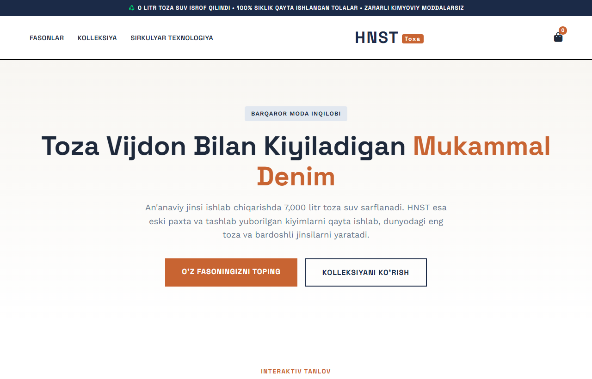

# HNST (Toxa) — 100% Qayta Ishlangan Sirkulyar Denim & Ekologik Jinsi Brendi

HNST — an'anaviy to'qimachilikdagi suv isrofgarchiligiga chek qo'yib, 100% qayta ishlangan paxta tolalari va tabiiy indigo bo'yoqlaridan tikiladigan premium sirkulyar denim brendining foydalanuvchi interfeysi (UI).

---

## 📸 Veb-Sahifa Ko'rinishi (Skrinshot)



---

## 🌟 Asosiy Imkoniyatlar va Funksiyalar

1. **Interaktiv Denim Fason Qidiruvi (Fit Finder)**:
   - To'g'ri (Straight), Keng (Wide), Ixcham (Slim) va Klesh (Flared) siluetlar tanlovi.
   - Har bir fason uchun mato zichligi (oz), bel balandligi va narxni bir zumda ko'rish.

2. **Sirkulyar Texnologiya Zanjiri**:
   - Zero Waste falsafasi, kiyimlarni qayta ishlashning 4 ta bosqichli modeli.

3. **Autentik Denim Estetikasi**:
   - Indigo ko'k va tabiiy mis ranglari uyg'unligi, *Space Grotesk* va *Work Sans* shriflarining zamonaviy ko'rinishi.

---

## 🛠 Texnologiyalar Steki

- **HTML5**: Semantik bloklar va SEO tayyorgarligi.
- **Vanilla CSS3**: Qat'iy geometriya, kontrast denim kartalari va moslashuvchan maket.
- **JavaScript (ES6+)**: Interaktiv fasonlar almashtirgichi va savat tizimi.

---

## 🚀 O'rnatish va Ishga Tushirish

1. Omborni klonlang:
   ```bash
   git clone https://github.com/qodirovtoirbektts-jpg/toxa-hnst.git
   ```
2. Papkaga kiring:
   ```bash
   cd toxa-hnst
   ```
3. `index.html` faylini brauzeringizda oching.

---

## 🔗 Jonli Havolalar

- **GitHub Repozitoriyasi**: [https://github.com/qodirovtoirbektts-jpg/toxa-hnst](https://github.com/qodirovtoirbektts-jpg/toxa-hnst)
- **Jonli Veb-Sahifa (GitHub Pages)**: [https://qodirovtoirbektts-jpg.github.io/toxa-hnst/](https://qodirovtoirbektts-jpg.github.io/toxa-hnst/)

---

## 👤 Muallif

- **Muallif**: Toxa ([qodirovtoirbektts-jpg](https://github.com/qodirovtoirbektts-jpg))
